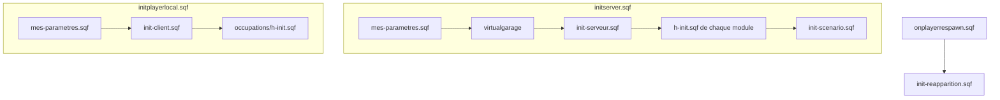

# Architecture

Cette page s'adresse à ceux qui veulent **comprendre ou étendre** hds-ops. Pour simplement l'utiliser, tu n'en as pas besoin.

---

## Ordre de démarrage



| Étape | Fichier | Rôle |
|---|---|---|
| Serveur 1 | `mes-parametres.sqf` | Ta configuration, détection des addons, déclaration des fonctions `fnc_hds_*` |
| Serveur 2 | `virtualgarage\virtualgarage.sqf` | Garage virtuel |
| Serveur 3 | `hdssystem\init-serveur.sqf` | Relations entre camps, réapparition automatique, curateur Zeus, textes traduits |
| Serveur 4 | `modules\*\h-init.sqf` | Déclaration des fonctions de chaque module |
| Serveur 5 | `hdssystem\init-scenario.sqf` | **Ton scénario** |
| Client | `hdssystem\init-client.sqf` | Configuration des slots joueurs, menus, lieux de soins, arsenaux, boutique |
| Réapparition | `hdssystem\init-reapparition.sqf` | Reconfiguration des slots après chaque réapparition |

> **Point important :** `initserver.sqf` et `initplayerlocal.sqf` utilisent `#include` (pas `execVM`). Tous ces fichiers s'exécutent donc dans le même contexte, et `mes-parametres.sqf` est lu **deux fois** : une fois par le serveur, une fois par chaque client.

---

## Organisation des dossiers

| Dossier | Contenu |
|---|---|
| `hdssystem\fonctions\` | Fonctions générales : arsenaux, médical, ravitaillement, missions, boutique… |
| `hdssystem\modules\occupations\` | Populations, garnisons, patrouilles par faction, renforts alliés, interfaces de recrutement |
| `hdssystem\modules\tactiques\` | IA tactique : planification, événements, tactiques |
| `hdssystem\modules\missions\` | Objectifs aléatoires (`objectif_*.sqf`) |
| `hdssystem\modules\scenario\` | Tâches scénarisées |
| `hdssystem\modules\commandant\` | Module expérimental |
| `gcam\`, `engima\Traffic\`, `virtualgarage\` | Outils tiers intégrés |

---

## Convention des fonctions

Chaque fonction est une **variable globale** `fnc_…`, créée par :

```sqf
fnc_mon_exemple = compile preprocessFile "hdssystem\fonctions\monexemple.sqf";
```

| Où est-elle déclarée ? | Quelles fonctions ? |
|---|---|
| `mes-parametres.sqf` | `fnc_hds_*` (arsenaux, garage, médical, ravitaillement, missions…) |
| `modules\<module>\h-init.sqf` | `fnc_objectif_*`, `fnc_tactique_*`, `fnc_scenario_*`, `fnc_hds_occupations`, `fnc_renfort_*` |
| `description.ext` (`CfgFunctions`) | Le module `commandant`, étiquette `aihds` |

### Ajouter une fonction

1. Crée le fichier `.sqf` (avec `params [...]` en première ligne).
2. Ajoute la ligne `compile preprocessFile` dans le bon `h-init.sqf` (ou dans `mes-parametres.sqf`).
3. Appelle-la avec `spawn` ou `call`.

> **Casse des chemins :** certaines déclarations ne respectent pas la casse réelle des fichiers (par exemple `objectif_cachearmes.sqf` pour le fichier `objectif_cacheArmes.sqf`). Ne renomme pas un fichier sans vérifier toutes ses références.

### Ajouter une faction

La faction est un `case` dans plusieurs fichiers. Il faut ajouter le même numéro dans :

- `modules\occupations\h-occupation.sqf` ;
- les tactiques : `renfort-terrestre.sqf`, `contre-attaque.sqf`, `insertion-defense.sqf` et `helicoptere-attaque.sqf` (dans `modules\tactiques\les_tactiques\`) ;
- éventuellement les listes de tirage (`HFactionennemi` dans `modules\occupations\h-init.sqf`).

---

## Textes traduits

Les textes affichés aux joueurs passent par `stringtable.xml` : une clé `str_hds_…`, lue avec `localize`, puis rangée dans une variable globale `hds_txt_…` (déclarée dans `init-serveur.sqf` et `init-client.sqf`).

---

## Le module `commandant`

Module expérimental, déclaré dans `CfgFunctions` (étiquette `aihds`).

| Fonction | Rôle |
|---|---|
| `aihds_fnc_definirunebase` | Choisit le meilleur emplacement de base sur une carte inconnue |
| `aihds_fnc_installerunebase` | Installe une base : `[position, ratio, faction, taille, camp]` |
| `aihds_fnc_cerveau` | Active la « réflexion » du commandant (définit une base puis l'installe) |

> Ce module n'est appelé par aucun autre fichier du dépôt. `aihds_fnc_cerveau` installe aujourd'hui une base avec des valeurs fixes (faction 5, camp `east`).
